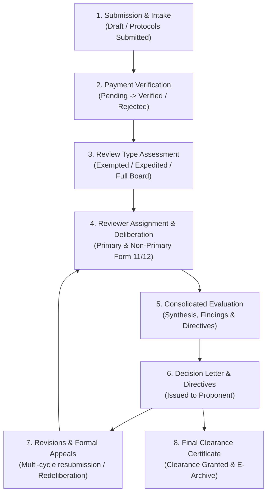

# Research Ethics Review Application and Management System

**Client Institution:** Research Ethics Committee (REC) — Ateneo de Zamboanga University (AdZU)  
**Course:** Web Systems and Technologies (WEBSYSTECH - B)  
**Development Team:** Team HASA (September – October 2026)  
**System Status:** Production-Grade / Active Operation

---

## 🛠 Technology Stack

| Layer | Technologies | Description |
| :--- | :--- | :--- |
| **Frontend SPA** | React 18, Vite 5, React Router DOM 6 | Modern Single-Page Application with declarative routing and optimized bundling |
| **Styling & UI Components** | Bootstrap 5.3, Bootstrap Icons 1.11 | Responsive 8-point spatial rhythm, glassmorphism, and custom AdZU brand theming |
| **Data Visualization** | Recharts 3.x | Real-time SVG telemetry, velocity curves, and collegiate protocol distribution charts |
| **Dialogs & Feedback** | SweetAlert2 11 | Accessible modals, confirmation workflows, and notification toasts |
| **Backend API** | PHP 8+ (RESTful Architecture) | Modular REST endpoints, atomic PDO transactions, and multipart file archiving |
| **Database Engine** | PostgreSQL 14+ / 16 (Port `54322`) | Hybrid 3NF Relational + JSONB document schema with native custom ENUMs |
| **Server & Gateway** | Apache (mod_rewrite / `.htaccess`) | Local proxy gateway routing `/api/(.*)` to PHP front controller |
| **Build & Tooling** | Vite, npm, Git | Hot-Module Replacement (HMR) development and production minification |

---

## 🏛️ System Overview & Institutional Context

The **Research Ethics Review Application and Management System** is a secure, institutional web platform engineered for the **Ateneo de Zamboanga University Research Ethics Committee (AdZU REC)**. It digitizes, accelerates, and audits the entire research ethics review process for human participant studies in accordance with the standards of the **Philippine Health Research Ethics Board (PHREB)**.

### User Roles & Operational Boundaries
- **Research Proponents (Internal & External):** Undergraduate students, graduate scholars, university faculty, and external health/institutional researchers (e.g., ZCMC, DOH, WMSU). Proponents submit protocol dossiers, upload Official Receipts, address committee revisions via clarification matrices, track review cycles, and download official Clearance Certificates.
- **REC Secretariat:** Administrative operational gatekeeper. Manages intake verification, audits financial Official Receipts (OR), monitors turnaround time SLAs (30-day compliance benchmark), manages multi-reviewer assignment schedules, logs immutable audit trails (`application_history`), and issues formal decision correspondence.
- **Ethics Committee Chair:** Senior academic decision-maker. Triages risk levels (`Exempted`, `Expedited`, `Full Board`), presides over committee deliberations, synthesizes multi-reviewer Form 11 / Form 12 evaluations into consolidated rulings, formulates actionable directives, signs decision notices, and grants final ethical clearance.
- **Primary & Non-Primary Reviewers:** Subject-matter and methodology experts. Conduct independent peer evaluations, grade rubric criteria across protocol validity and informed consent, provide qualitative feedback, and submit evaluative recommendations (`Approved`, `Minor Revisions`, `Major Revisions`, `Disapproved`).

---

## 🔄 The 8-Stage Research Ethics Review Lifecycle

The application operates as an event-driven state machine governing the 8 distinct phases of ethical review:



1. **Stage 1 — Submission & Intake:** Proponent drafts, validates, and submits study protocol package via the multi-step `ApplicantForm.jsx` intake wizard. The system assigns a unique Protocol Code (e.g., `2026-0098`), generates an initial `research_applications` record, and logs an `Initial Submission` event in `application_history`.
2. **Stage 2 — Payment Verification:** Application transitions to `Payment Pending`. Proponent settles evaluation fees at the AdZU Cashier and uploads the Official Receipt (OR) via `SubmitORModal`. Secretariat audits receipt legitimacy via `PaymentVerificationModal`. Validated payments transition to `Payment Verified`; discrepancies are returned with feedback via `PaymentRejectionNoticeModal`.
3. **Stage 3 — Review Type Assessment:** Ethics Chair evaluates protocol risk in `ReviewTypeModal`, classifying it as `Exempted`, `Expedited`, or `Full Board`. If pre-review revisions are required, the Chair reverts the dossier to the proponent before committing reviewer resources.
4. **Stage 4 — Reviewer Assignment & Deliberation:** Primary and Non-Primary Reviewers are assigned based on specialty. Reviewers conduct independent evaluations using standardized **Form 11 (Protocol Evaluation)** and **Form 12 (Informed Consent Evaluation)** via `OngoingReviewModal`, submitting verdicts (`Approved`, `Minor Revisions`, `Major Revisions`, `Disapproved`).
5. **Stage 5 — Consolidated Evaluation:** In `ConsolidationModal`, the Chair synthesizes individual evaluations, determines unanimous or split committee consensus, formalizes per-question findings, and compiles legally binding actionable directives into `consolidated_evaluations`.
6. **Stage 6 — Decision Letter & Directives:** A formal university Form 13 Decision Notice is compiled and dispatched to the applicant dashboard (`ApplicantDecisionLetterModal`).
7. **Stage 7 — Revision, Resubmission, or Appeal:**
   - **Revisions:** Proponents submit clean documents, tracked-changes documents, and point-by-point clarification matrices via `ReviseProtocolModal`. Increments `current_cycle` and routes to `RevisionsVerificationModal`.
   - **Appeals:** Disapproved protocols may file a formal re-deliberation request with updated study instruments and MOAs via `ProtocolAppealModal`.
8. **Stage 8 — Final Clearance Certificate:** Upon complete satisfaction of all ethical directives, the Chair finalizes clearance date. The system generates an official **Ethical Clearance Certificate** with 1-year validity, transitions the protocol to `Clearance Granted`, and permanently archives the docket.

---

## 🗄️ Database Architecture & Data Model (PostgreSQL)

The system is backed by a native **PostgreSQL** relational engine utilizing a hybrid **3NF Normalized Relational Schema** and **PostgreSQL JSONB Semi-Structured Document Storage**.

### 1. Connection Infrastructure (`backend/config/Database.php`)
- **DBMS:** PostgreSQL 14+ / 16
- **Host / Port:** `127.0.0.1` : `54322`
- **Database Catalog:** `postgres`
- **Driver:** PHP Data Objects (`PDO`) with `pdo_pgsql`
- **Encoding:** `UTF-8`

### 2. Entity-Relationship Model

```
                    ┌─────────────────────────┐
                    │       applicants        │
                    └───────────┬─────────────┘
                                │ 1
                                │
                                │ n
                    ┌───────────▼─────────────┐       1        ┌─────────────────────────┐
                    │  research_applications  │────────────────│        payments         │
                    └───────────┬─────────────┘                └─────────────────────────┘
                                │
         ┌──────────────────────┼──────────────────────┬──────────────────────┐
         │ 1                    │ 1                    │ 1                    │ 1
         │                      │                      │                      │
         │ n                    │ n                    │ n                    │ n
┌────────▼────────────┐ ┌───────▼────────────┐ ┌───────▼────────────┐ ┌───────▼────────────┐
│ research_documents  │ │  protocol_reviews  │ │application_history │ │   notifications    │
└─────────────────────┘ └───────┬────────────┘ └────────────────────┘ └────────────────────┘
                                │ n
                                │
                                │ 1
                        ┌───────▼────────────┐
                        │       admins       │
                        └───────▲────────────┘
                                │ 1
                                │
                                │ n
                        ┌───────┴─────────────────────┐
                        │  consolidated_evaluations   │
                        └─────────────────────────────┘
```

### 3. Core Database Tables

| Table Name | Primary Key | Foreign Keys & Constraints | Purpose |
| :--- | :--- | :--- | :--- |
| **`applicants`** | `applicant_id SERIAL` | `email` UNIQUE | Proponent credentials, internal/external affiliation, and department/agency. |
| **`admins`** | `admin_id SERIAL` | `email` UNIQUE | Secretariat, Ethics Chair, and assigned peer reviewers with specialization tags. |
| **`research_applications`** | `application_id SERIAL` | `applicant_id` ➔ `applicants` (CASCADE) | Master protocol records (`protocol_code` UNIQUE), lifecycle status, review classification, cycles, and primary `form_data` JSONB. |
| **`payments`** | `payment_id SERIAL` | `application_id` ➔ `research_applications` (CASCADE)<br>`verified_by_admin_id` ➔ `admins` (SET NULL) | Financial verification records, Official Receipt (OR) numbers, amounts, receipts, and audit timestamps. |
| **`research_documents`** | `document_id SERIAL` | `application_id` ➔ `research_applications` (CASCADE) | Electronic document repository linking uploaded files (protocols, consent forms, CVs, instruments, matrices). |
| **`protocol_reviews`** | `review_id SERIAL` | `application_id` ➔ `research_applications` (CASCADE)<br>`reviewer_id` ➔ `admins` (RESTRICT)<br>`UNIQUE (application_id, reviewer_id, cycle_number)` | Individual peer review assignments, Form 11 / Form 12 evaluation scores, and reviewer recommendations. |
| **`consolidated_evaluations`**| `consolidation_id SERIAL` | `application_id` ➔ `research_applications` (CASCADE)<br>`chair_id` ➔ `admins` (RESTRICT)<br>`UNIQUE (application_id, cycle_number)` | Stage 5 Review Synthesis: Chair consensus rulings, actionable revision directives, and compliance checklists. |
| **`application_history`** | `history_id SERIAL` | `application_id` ➔ `research_applications` (CASCADE) | Immutable audit trail tracking state transitions, rejection cycles, attempt numbers, and timestamps. |
| **`notifications`** | `notification_id SERIAL` | `application_id` ➔ `research_applications` (CASCADE) | System alerts, revision requests, clearance notifications, and delivery timestamps. |

### 4. Custom PostgreSQL ENUM Types
Data integrity is strictly enforced at the database catalog level via native PostgreSQL `ENUM` types:
- **`affiliation_enum`**: `'Internal'`, `'External'`
- **`admin_role_enum`**: `'Secretariat'`, `'Ethics Chair'`, `'Primary Reviewer'`, `'Non-Primary Reviewer'`
- **`research_type_enum`**: `'Undergraduate'`, `'Graduate'`, `'Faculty'`, `'Externally Funded'`
- **`review_type_enum`**: `'Undetermined'`, `'Exempted'`, `'Expedited'`, `'Full Board'`
- **`status_enum`**: `'Draft'`, `'Protocols Submitted'`, `'Payment Pending'`, `'Payment Verified'`, `'Type of Review'`, `'Ongoing Review'`, `'Consolidation of Evaluation'`, `'Decision Letter Issued'`, `'Revisions Submitted'`, `'Clearance Granted'`, `'Rejected'`, `'Withdrawn'`, `'Amendments'`
- **`payment_status_enum`**: `'Pending'`, `'Verified'`, `'Rejected'`
- **`recommendation_enum`**: `'Approved'`, `'Minor Revisions'`, `'Major Revisions'`, `'Disapproved'`
- **`process_point_enum`**: `'Initial Submission'`, `'Payment Required'`, `'Payment Verification'`, `'Review Type Assessment'`, `'Ethical Review'`, `'Decision Issued'`, `'Proponent Revisions'`, `'Revisions Verification'`, `'Clearance Granted'`, `'Application Rejected'`, `'Application Withdrawn'`, `'Protocol Revision'`, `'Consolidation of Review'`, `'Protocol Appeal'`, `'Appeal Re-deliberation'`

### 5. Semi-Structured JSONB Architecture
Semi-structured data is stored in indexed `JSONB` columns, avoiding fragile schema migrations:
- **`research_applications.form_data`**: Dynamic multi-investigator rosters (`primary_researchers`, `co_researchers`), checklist requirements, study sites, sample sizes, and revision submission archives.
- **`protocol_reviews.form_data`**: Granular criteria evaluations across Form 11 (protocol validity, risk-benefit, vulnerability) and Form 12 (informed consent, translation, compensation).
- **`consolidated_evaluations.per_question_findings` & `actionable_directives`**: Indexed with GIN (`idx_consolidation_findings_gin`, `idx_consolidation_directives_gin`) to capture directive requirements and satisfaction states across cycles.

### 6. Active Database Metrics & Institutional Scope
The live PostgreSQL database manages **98 research protocols** across **12 distinct applicant departments and partner institutions**:
- **Internal AdZU Protocols:** **90 protocols (91.8%)** across 8 Academic Colleges & Schools:
  - `CSITE` — College of Science, Information, Technology, and Engineering (17 protocols)
  - `SOM` — School of Medicine (18 protocols)
  - `CON` — College of Nursing (14 protocols)
  - `SEd` — School of Education (11 protocols)
  - `SLA` — School of Liberal Arts (9 protocols)
  - `SMA` — School of Management and Accountancy (9 protocols)
  - `GS` — Graduate School (7 protocols)
  - `Law` — Rosendo U. Castillo Jr. College of Law (5 protocols)
- **External Partner Protocols:** **8 protocols (8.2%)** across 4 affiliate institutions:
  - `ZCMC` — Zamboanga City Medical Center (Tertiary Teaching Hospital)
  - `DOH` — Department of Health - Center for Health Development IX (CHD IX)
  - `WMSU` — Western Mindanao State University
  - `BRENT` — Brent Hospital and Colleges, Inc.

---

## 🎨 UI/UX Architecture & Design System

### 1. Brand System & Color Taxonomy
The user interface follows the **80/20 Color Sparsity Rule**, maintaining a clean neutral canvas with purposeful semantic color tokens:
- **AdZU Navy (`#003366` / `--primary: #060297`):** Primary brand identity, header banners, and primary CTA buttons.
- **AdZU Gold (`#b8860b` / `--tertiary: #d26000`):** Secondary institutional accents, badges, and warning highlights.
- **Status Color Taxonomy:**
  - **Emerald Green (`#198754`):** Clearance Granted, Approved, SLA Compliant.
  - **Warning Amber (`#ffc107`):** Payment Pending, Revisions Required, Type of Review.
  - **Cyan / Info (`#0dcaf0`):** Protocols Submitted, Payment Verified, Revisions Submitted.
  - **Crimson Red (`#dc3545`):** Disapproved, Payment Rejected, Terminal Disapproval.

### 2. Proponent Profile Pill Dropdown Pattern
Implemented in `DashboardHeader.jsx`, the user account widget combines a glassmorphic pill button with an anchored floating menu:
- **Pill Shape:** `rounded-pill` geometry with `min-height: 44px` for WCAG touch compliance.
- **Glassmorphism:** `backgroundColor: rgba(255, 255, 255, 0.12); backdrop-filter: blur(6px);`.
- **Anchoring:** Wrapper uses `position-relative`; dropdown uses `position-absolute end-0 mt-2` for seamless positioning without JavaScript coordinate calculations.
- **Defensive Truncation:** Proponent name and department enforce `maxWidth: 160px` with `text-truncate`.
- **Dismissal Lifecycle:** Document-level `mousedown` ref check and `Escape` key event listeners.

### 3. Responsive Layout & Print Engine
- **Mobile-First Actions:** Multi-button control strips collapse into full-width thumb-reach targets (`w-100 w-sm-auto`) on mobile viewports (<576px).
- **Flexbox Immunity:** Sibling toolbars use `flex-shrink-0 flex-sm-nowrap` to prevent button drops on standard 992px–1366px laptop screens.
- **Isolated Iframe Print Engine (`printHelper.js`):** Off-screen sandboxed `<iframe>` print renderer that clones university stylesheets and pre-hydrates the official AdZU Seal (`adzuSeal`), ensuring clean, single-page official letterheads without header clipping or blank pages.

---

## 📁 Repository Directory Structure

```
REC-Review-Application-Management/
├── SRS and Flowchart/                               # System Specifications & Diagrams
│   ├── Flowchart for Process in System.png
│   └── WEBSYSTECH_SRS_Team-HASA.pdf
├── database/                                        # PostgreSQL DDL & Migration Scripts
│   ├── migrations/
│   │   └── 005_consolidated_evaluations.sql
│   └── database_schema.sql                          # Complete PostgreSQL 3NF Schema & Seeds
├── backend/                                         # PHP REST API Backend
│   ├── api/
│   │   ├── assign_review_type.php                   # Stage 3 Review classification endpoint
│   │   ├── get_consolidation_data.php               # Stage 5 Consolidation evaluation fetcher
│   │   ├── get_payment.php                          # Payment verification details
│   │   ├── get_reviewers.php                        # Reviewer roster & workload telemetry
│   │   ├── index.php                                # Master API Router (/api/applications)
│   │   ├── login_admin.php                          # Admin & Reviewer authentication
│   │   ├── login_applicant.php                      # Proponent authentication
│   │   ├── protocol_history.php                     # Audit trail history retrieval
│   │   ├── save_consolidation.php                   # Stage 5 Consolidation persistence
│   │   ├── submit_or_details.php                    # Stage 2 OR submission handler
│   │   ├── submit_post_review_revision.php          # Stage 7 Post-review revision handler
│   │   ├── submit_protocol_appeal.php               # Stage 7 Formal appeal submission
│   │   ├── submit_protocol_revision.php             # Stage 3 Pre-review revision handler
│   │   ├── submit_review_evaluation.php             # Stage 4 Form 11/12 reviewer evaluation
│   │   ├── verify_payment.php                       # Stage 2 Secretariat payment approval
│   │   └── verify_revisions_and_grant_clearance.php # Stage 8 Final clearance sign-off
│   ├── config/
│   │   ├── cors.php                                 # CORS & response headers middleware
│   │   └── database.php                             # PostgreSQL PDO connection handler
│   ├── controllers/
│   │   └── history_helper.php                       # Audit logging helper utility
│   ├── uploads/                                     # E-Archiving document storage
│   │   ├── decisions/                               # Generated decision letters
│   │   ├── documents/                               # Protocols, consent forms, matrices
│   │   └── payments/                                # Uploaded cashier receipts
│   └── .htaccess                                    # Apache mod_rewrite routing gateway
├── frontend/                                        # Client-Side React 18 Application
│   ├── public/                                      # Static public assets
│   ├── src/
│   │   ├── assets/
│   │   │   └── AdZU Seal.png                        # Official University Institutional Seal
│   │   ├── components/
│   │   │   ├── admin/
│   │   │   │   ├── ConsolidatedDecisionLetterModal.jsx # Form 13 Decision Notice print studio
│   │   │   │   ├── ConsolidationModal.jsx           # Stage 5 Chair review consolidation
│   │   │   │   ├── ExecutiveKpiTiles.jsx            # 4-Tile Workload & SLA telemetry strip
│   │   │   │   ├── OngoingReviewModal.jsx           # Form 11 & Form 12 peer review engine
│   │   │   │   ├── PaymentVerificationModal.jsx     # Secretariat payment audit modal
│   │   │   │   ├── ResearchProtocolModal.jsx        # Protocol dossier & lifecycle stepper
│   │   │   │   ├── ReviewTypeModal.jsx              # Review classification triage modal
│   │   │   │   └── RevisionsVerificationModal.jsx   # Revision & compliance check modal
│   │   │   ├── applicant/
│   │   │   │   ├── ActionRequiredTray.jsx           # High-priority alert bar for proponents
│   │   │   │   ├── ApplicantDecisionLetterModal.jsx # Proponent Form 13 directive viewer
│   │   │   │   ├── ApplicationNewButton.jsx         # New submission CTA button
│   │   │   │   ├── ApplicationRow.jsx               # Table row with dynamic workflow badges
│   │   │   │   ├── ApplicationSearchBar.jsx         # Query debouncer & quick filter bar
│   │   │   │   ├── ApplicationsTable.jsx            # Virtualized sticky-header table grid
│   │   │   │   ├── DashboardFooter.jsx              # Institutional footer anchor
│   │   │   │   ├── DashboardHeader.jsx              # Glassmorphic navbar & Profile Pill
│   │   │   │   ├── PaymentRejectionNoticeModal.jsx  # Payment deficiencies notice modal
│   │   │   │   ├── ProtocolAppealModal.jsx          # Formal protocol appeal engine
│   │   │   │   ├── ProtocolRevisionNoticeModal.jsx  # Pre-review revision directives modal
│   │   │   │   ├── ReviseProtocolModal.jsx          # Clarification matrix & upload engine
│   │   │   │   ├── SidebarFilter.jsx                # Review category navigation sidebar
│   │   │   │   ├── SortableTh.jsx                   # Interactive table column header
│   │   │   │   ├── StatusBadge.jsx                  # Semantic status taxonomy chip
│   │   │   │   └── SubmitORModal.jsx                # Cashier Official Receipt upload modal
│   │   │   ├── AdminLayout.jsx                      # Admin shell with sticky nav
│   │   │   ├── AdminSidebar.jsx                     # Admin sidebar navigation & role guard
│   │   │   └── ErrorBoundary.jsx                    # Application-wide crash fallback
│   │   ├── constants/
│   │   │   └── applicationTypes.js                  # Taxonomy mappings & table columns
│   │   ├── hooks/
│   │   │   ├── useApplications.js                   # Application data fetching & cache
│   │   │   └── useTableSortFilter.js                # Sorting & substring search engine
│   │   ├── pages/
│   │   │   ├── ApplicationCreate/
│   │   │   │   ├── components/
│   │   │   │   │   ├── FileUploadWidget.jsx         # Drag-and-drop file uploader
│   │   │   │   │   ├── InfoTooltip.jsx              # Accessible popover guideline tooltip
│   │   │   │   │   ├── RadioCardGroup.jsx           # Card-based radio options
│   │   │   │   │   ├── ResearcherManager.jsx        # Multi-investigator roster manager
│   │   │   │   │   └── SectionCard.jsx              # Form section accordion container
│   │   │   │   └── ApplicantForm.jsx                # 3-Stage application intake wizard
│   │   │   ├── Auth/
│   │   │   │   ├── AdminLogin.jsx                   # Administrative login portal
│   │   │   │   └── ApplicantLogin.jsx               # Proponent single-sign-on portal
│   │   │   ├── AdminAnalytics.jsx                   # Institutional Analytics Studio
│   │   │   ├── AdminDashboard.jsx                   # Master Secretariat Protocol Hub
│   │   │   ├── AdminHome.jsx                        # Executive Overview & Triage Queue
│   │   │   └── ApplicantDashboard.jsx               # Proponent Protocol Management Hub
│   │   ├── services/
│   │   │   └── api.js                               # Fetch API client with error parser
│   │   ├── utils/
│   │   │   ├── applicationFilters.js                # Multi-field filtering & query match
│   │   │   ├── formatters.js                        # Date, currency, & code formatters
│   │   │   └── printHelper.js                       # Sandboxed iframe PDF print engine
│   │   ├── App.jsx                                  # React Router route registry
│   │   ├── index.css                                # Global theme & responsive rules
│   │   └── main.jsx                                 # React root bootstrap entry
│   ├── index.html                                   # HTML5 shell & favicon
│   ├── package.json                                 # Node dependencies & build scripts
│   └── vite.config.js                               # Vite config & API reverse proxy
├── .gitignore
└── README.md
```

---

## 🚀 Setup & Installation Guide

### Prerequisites
- **PostgreSQL 14+ / 16** running locally on port **`54322`** (or configured port).
- **PHP 8.1+** with the following extensions enabled in `php.ini`:
  ```ini
  extension=pdo_pgsql
  extension=pgsql
  extension=fileinfo
  extension=curl
  ```
- **Apache Web Server** with `mod_rewrite` enabled.
- **Node.js 18+** & **npm 9+**.

---

### Step 1: Database Initialization (PostgreSQL)

1. Connect to your PostgreSQL server instance using `psql`:
   ```bash
   psql -h 127.0.0.1 -p 54322 -U postgres -d postgres
   ```
2. Import the complete 3NF schema, custom ENUM types, and seed dataset:
   ```bash
   psql -h 127.0.0.1 -p 54322 -U postgres -d postgres -f database/database_schema.sql
   ```
3. Test connectivity using the PHP CLI:
   ```bash
   php -r "require 'backend/config/database.php'; \$db = (new Database())->getConnection(); echo 'PostgreSQL Connected Successfully!' . PHP_EOL;"
   ```

---

### Step 2: Backend Setup (Apache + PHP)

1. Place or clone this repository under your web root:
   - For XAMPP: `C:/xampp/htdocs/REC-Review-Application-Management`
   - For custom VirtualHost: Ensure document root maps to the repository root.
2. Ensure write permissions for document uploads:
   ```bash
   chmod -R 775 backend/uploads/
   ```
3. Verify Apache `mod_rewrite` is enabled. The included `backend/.htaccess` automatically rewrites `/api/(.*)` requests to `backend/api/index.php`.

---

### Step 3: Frontend Setup (React 18 + Vite)

1. Navigate to the `frontend/` directory and install project dependencies:
   ```bash
   cd frontend
   npm install
   ```
2. Start the local Vite development server:
   ```bash
   npm run dev
   ```
3. Open your browser and navigate to:
   ```
   http://localhost:5173
   ```
   *(The Vite development server reverse-proxies `/api` requests to `http://localhost/REC-Review-Application-Management/backend`)*.

4. To test a production build:
   ```bash
   npm run build
   npm run preview
   ```

---

## 🔐 Default Test Credentials

> [!NOTE]
> All pre-seeded administrative and applicant test accounts in the local development database share the unified default password: `password123`.

| Role | Username / Email | Password | Access Scope |
| :--- | :--- | :--- | :--- |
| **Ethics Chair** | `chair@adzu.edu.ph` | `password123` | Full Administrative & Deliberation Console |
| **Secretariat** | `secretariat@adzu.edu.ph` | `password123` | Intake, Payment Audit, Triage & Archiving |
| **Primary Reviewer** | `primary@adzu.edu.ph` | `password123` | Form 11 / Form 12 Rubric Evaluations |
| **Non-Primary Reviewer** | `nonprimary@adzu.edu.ph` | `password123` | Independent Review & Recommendation |
| **Proponent (Internal)** | `applicant@adzu.edu.ph` | `password123` | Protocol Submission, OR Upload, Revisions |
| **Proponent (External)** | `esantos@zcmc.doh.gov.ph` | `password123` | External Hospital Protocols & Appeals |

---

## 📄 License & Institutional Compliance

Developed exclusively for the **Ateneo de Zamboanga University Research Ethics Committee (AdZU REC)**. All rights reserved. Complies with the **National Ethical Guidelines for Health and Health-Related Research (NEGHHR)** and the **Philippine Data Privacy Act of 2012 (RA 10173)**.
